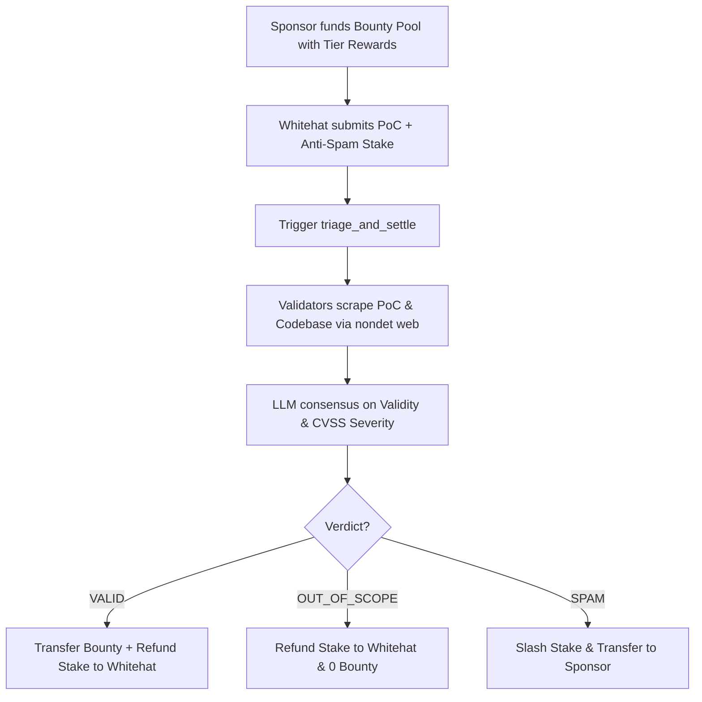

# GenLayer Intelligent Contract Primitives & Protocol Suite

A comprehensive repository of production-grade, educational, and reusable GenLayer Intelligent Contract primitives demonstrating real decentralized AI-validator consensus, non-deterministic web verification, and autonomous on-chain settlement.

---

## 📦 Intelligent Contract Primitives in this Repository

### 1. `AutonomousBountyOracle.py` — Decentralized Bug Bounty Triage & Settlement Primitive 🛡️
A decentralized bug bounty and vulnerability verification primitive for Web3 protocols and DAOs. Eliminates centralized triage bottlenecks (e.g. Immunefi/HackerOne delays or subjective dismissal) by utilizing multi-validator LLM consensus to verify exploit proof-of-concepts, calculate CVSS severities, and execute automated payouts.

- **Non-Deterministic Web Inspection (`gl.nondet.web.render`)**: Validators fetch the reported vulnerability advisory / GitHub PoC URL and verify live exploitability against the project's in-scope codebase.
- **Equivalence Principle Consensus (`gl.eq_principle.strict_eq`)**: Independent validator LLMs evaluate the bug report against the smart contract scope, assess severity (Critical, High, Medium, Low), and reach strict consensus on the verdict.
- **Anti-Spam Staking & Slashing**: Researchers deposit an anti-spam stake. Valid findings receive full stake refund + bounty reward. Out-of-scope reports receive stake refund with zero bounty. Malicious/spam submissions have their stake slashed and transferred to the pool sponsor.
- **Multi-Tranche Funding & Settlement**: Sponsors fund bounty pools with customized reward tiers. Funds are autonomously transferred directly to the whitehat's wallet upon consensus.

---

### 2. `ArbitratedEscrow.py` & `MilestoneEscrow.py` — Autonomous Milestone Escrow with AI Arbitration ⚖️
A decentralized commerce and freelance escrow primitive that arbitrates subjective deliverable disputes through multi-validator consensus.

- **Deterministic Contract-Derived Escrow IDs (`get_next_escrow_id`)**: Escrow creation and funding use an on-chain predictable identifier directly from the contract, eliminating description-scanning or guessing.
- **Deadlock-Proof Default Resolution with Protected Response Window (`request_default_settlement` -> `resolve_dispute_default`)**: Prevents either party from locking disputed funds indefinitely while guaranteeing the counterparty a challenge/response window before funds can be released. Immediate calls strictly revert. If the counterparty responds, the default notice is canceled; if they remain unresponsive after the window expires, 100% default payout/refund is finalized.
- **Phased Tranche Releases**: Supports multi-milestone deliverables with independent funding, reviews, and payouts.
- **Race-Condition & Front-Running Prevention**: Enforces bilateral statements or explicit waivers (`waive_dispute_statement`) before adjudication can be triggered.
- **Live DApp Integration**: Directly integrated with GenLayer Bradbury Testnet (`0x92Fd227790835A5B9F2c8681B21c19Ab4db61D5a`).

---

## 🏛️ Architecture & State Machines

### `AutonomousBountyOracle` Lifecycle


---

## 🧪 Comprehensive Unit Test Suite

All contracts are verified with 22 automated unit tests executing in Direct Mode:

```bash
pytest
```

```text
tests/test_arbitrated_escrow.py .........                                [ 42%]
tests/test_bounty_oracle.py .....                                        [ 66%]
tests/test_multi_milestone_escrow.py ...                                 [ 80%]
tests/test_parametric_insurance.py ....                                  [100%]

============================= 21 passed in 0.08s ==============================
```

### Test Coverage Breakdown:
1. **`test_deterministic_contract_derived_escrow_id`**: Verifies deterministic identifier generation (`get_next_escrow_id`) and sequential deposit routing without description scanning.
2. **`test_default_dispute_resolution_when_seller_withholds_statement`**: Verifies 100% refund default transition to buyer when seller withholds statement/waiver.
3. **`test_default_dispute_resolution_when_buyer_withholds_statement`**: Verifies 100% payout default transition to seller when buyer withholds statement/waiver.
4. **`test_multiple_escrows_creation_and_funding`**: Sequential multi-escrow creation and funding.
5. **`test_dispute_race_condition_prevented_and_resolved` & `test_dispute_explicit_waiver_path`**: Strict bilateral consensus and explicit waiver flows.
6. **`test_bounty_oracle.py` & `test_parametric_insurance.py`**: Complete security and insurance oracle coverage.

---

## 🔗 Live Deployment & Resources
- **Project DApp Repository:** [https://github.com/earnadvise/arbitrated-escrow-dapp](https://github.com/earnadvise/arbitrated-escrow-dapp)
- **Intelligent Contract Suite:** [https://github.com/earnadvise/genlayer-intelligent-escrow](https://github.com/earnadvise/genlayer-intelligent-escrow)
- **Bradbury Contract:** `0x92Fd227790835A5B9F2c8681B21c19Ab4db61D5a`
- **Live DApp:** [https://earnadvise.github.io/genlayer-escrow-dapp](https://earnadvise.github.io/genlayer-escrow-dapp)
